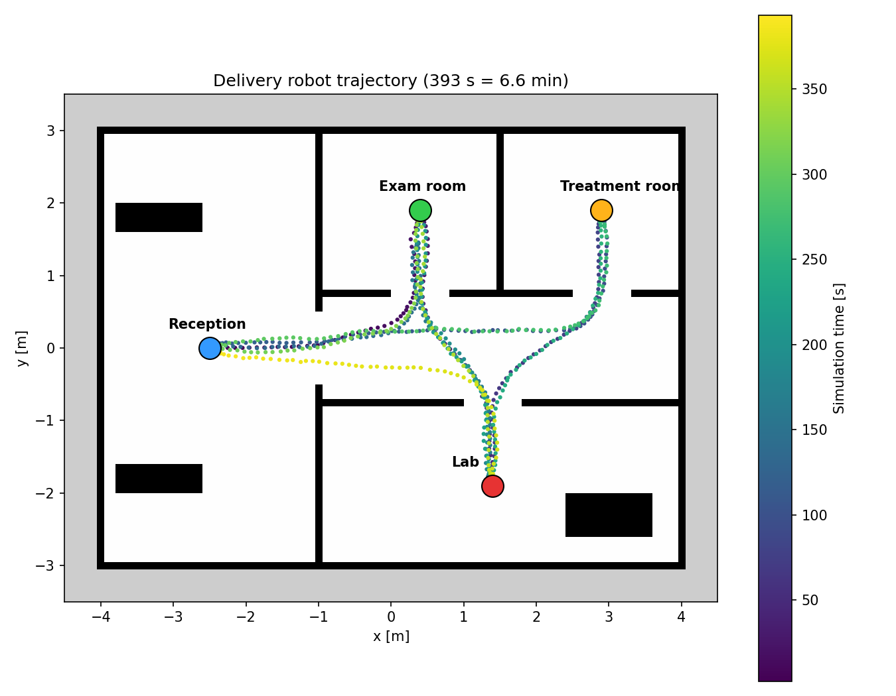
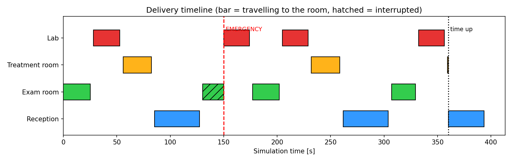

# 院内搬送ロボット（Gazebo Fortress × ROS 2 Humble × Nav2）

Physical AI 最終課題。小規模な診療所を模したシミュレーション空間で、差動二輪ロボットが
**診療所の業務フローに沿って物品を自律搬送し、6分間の運用を完遂する**システムです。



## 概要

| 項目 | 内容 |
|---|---|
| シミュレータ | Gazebo Fortress（Ignition） |
| ミドルウェア | ROS 2 Humble、ros_gz_bridge |
| 自律移動 | Nav2（AMCL による自己位置推定、NavFn 経路計画、Regulated Pure Pursuit 追従） |
| センサ | 2D LiDAR（360本、10 Hz） |
| ミッション | nav2_simple_commander による Python スクリプト |

## 工夫した点（オリジナリティ）

1. **臨床現場の業務フローをタスクにした**
   受付 → 診察室（カルテ・書類）→ 検査室（検体）→ 処置室（処置物品）→ 受付 を巡回し、
   各地点で受け渡しを模擬して停車します。
2. **緊急検体の割り込み**
   `/emergency` トピックで部屋名を受けると、移動中のタスクを中断して最優先で向かい、
   完了後に中断したタスクを再開します。
3. **「6分間」を設計の中心に据えた運用**
   シミュレーション時間で 360 秒経過すると搬送を打ち切って受付へ自動帰還し、
   搬送件数・走行距離・所要時間などを自動で記録・集計します。
4. **評価指標の可視化**
   走行軌跡とタイムラインを自動でグラフ化し、6分間で何件運べたかを定量評価します。
5. **地図の作り方の検証**
   slam_toolbox による地図作成を試したところ、ソフトウェア描画環境では回転時に推定がずれることが分かったため、
   ワールドの設計座標から誤差のない占有格子地図を生成して使用しました。

## 実験結果（2026-10-25 実施）

| 指標 | 結果 |
|---|---|
| 総経過時間 | 393.5 秒（6.6 分）※360秒で搬送打ち切り後、受付へ帰還 |
| 搬送件数 | 8 件（診察室 3・検査室 3・処置室 2） |
| 緊急対応 | 1 件（150秒時点で割り込み、約24秒で検査室に到着） |
| 到着失敗 | 0 件 |
| 走行距離 | 58.5 m |
| 実時間比（RTF） | 0.98 |



## 診療所ワールド

8 m × 6 m。左に受付・待合（ベンチ2台）、中央に廊下、右上に診察室・処置室、右下に検査室（検査台）。
扉の幅はすべて 0.8 m、ロボットの幅は 0.21 m です。

| 地点 | 座標 (x, y) [m] |
|---|---|
| 受付 reception | (-2.5, 0.0) |
| 診察室 exam | (0.4, 1.9) |
| 処置室 treatment | (2.9, 1.9) |
| 検査室 lab | (1.4, -1.9) |

## ファイル構成

```
src/clinic_delivery/
├── worlds/clinic.sdf            診療所ワールド
├── models/delivery_bot/         搬送ロボット（差動二輪＋LiDAR）
├── maps/clinic_map.{pgm,yaml}   占有格子地図
├── config/bridge.yaml           ROS 2 ⇔ Gazebo ブリッジ設定
├── config/nav2_params.yaml      Nav2 パラメータ
├── launch/sim.launch.py         Gazebo＋ブリッジの起動
├── launch/nav.launch.py         上記＋Nav2＋RViz の一括起動
└── clinic_delivery/
    ├── stations.py              各地点の座標
    ├── go_to.py                 指定した部屋へ移動（動作確認用）
    ├── mission.py               搬送ミッション本体
    └── plot_mission.py          結果のグラフ化
results/                         実験結果
```

## 動かし方

動作確認環境: Ubuntu 22.04、ROS 2 Humble、Gazebo Fortress、Nav2（Docker イメージ
`airobotbook/ros2-desktop-ai-robot-book-humble`）

```bash
mkdir -p ~/ros2_ws && cd ~/ros2_ws
git clone <このリポジトリのURL> .
colcon build
source install/setup.bash

# 端末1：シミュレーション＋Nav2＋RViz
ros2 launch clinic_delivery nav.launch.py
#   gui:=false       Gazebo の画面なし（軽量）
#   use_amcl:=false  自己位置推定を使わない

# 端末2：搬送ミッション（150秒時点で検査室への緊急割り込みを自動発生）
ros2 run clinic_delivery mission --ros-args -p emergency_at:=150.0
#   結果の保存先（標準 /workspace/ros2_ws/results）は -p result_dir:=<保存先> で変更可

# 手動で緊急割り込み
ros2 topic pub --once /emergency std_msgs/msg/String "{data: lab}"

# 結果のグラフ化
ros2 run clinic_delivery plot_mission
```

## 参考

- Gazebo Docs: https://gazebosim.org/docs/fortress
- Nav2 Documentation: https://docs.nav2.org/
- 参考記事「gazeboとROS2の連携」（差動駆動・ros_ign_bridge・launch の構成を参考にしました）
